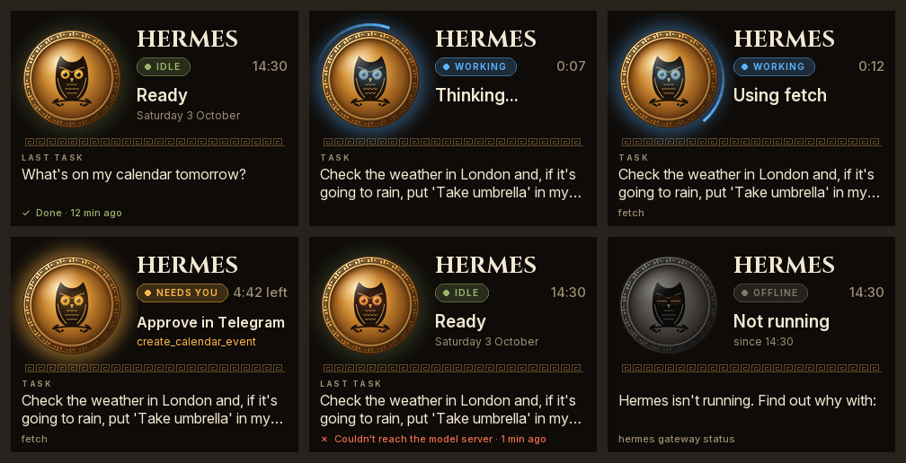
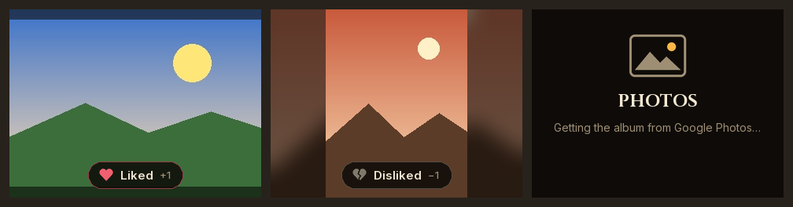

# pi-display-microservice

Hermes' status board: what [Hermes](https://hermes-agent.nousresearch.com) is doing, on a [Pimoroni Display HAT Mini](https://pinout.xyz/pinout/display_hat_mini) on a Raspberry Pi. In between, it can show a slideshow of your photos.



- **Idle:** the time, and how your last request went.
- **Working:** your request, what Hermes is doing now (thinking, or which tool it's using), the tools it has used and how long it's taken. A light runs round the shield, and the LED is blue.
- **Needs you:** a tool is waiting for your approval in Telegram. The shield pulses amber, the LED flashes amber, and the clock counts down to when the request is denied automatically.
- **Offline:** Hermes isn't answering. If that's for a reason other than Hermes not running, such as a wrong token, the board says what it is.



The photo page shows the photos in a Google Photos album, a new one every 5 minutes. The ones you like come up more often, and the ones you dislike less often. See [The photo slideshow](#the-photo-slideshow).

## The buttons

The board has two pages: the photos, if you've given it an album, and Hermes' status. It starts on the photos.

| Button | What it does |
|---|---|
| A, top left | Turns the screen off, and on again |
| B, bottom left | Moves to the next page: from the photos to Hermes' status, and back |
| X, top right | On the photos: likes the photo on screen, so it comes up more often. When Hermes is waiting for your approval: approves |
| Y, bottom right | On the photos: dislikes the photo on screen, so it comes up less often. When Hermes is waiting for your approval: denies |

Approving or denying on the board works like `/approve` or `/deny` in the chat: the screen says "Approving…" until Hermes carries on, and if the answer doesn't go through, it says why. It only works for approvals Hermes is waiting for in a messaging chat, like Telegram or your phone's. One asked in the Hermes app, or in a terminal, has to be answered there: press X or Y and the board says so.

While the screen is off, any button turns it back on. It also comes on by itself whenever Hermes is working or needs you, showing Hermes' status, and goes off again when Hermes is done. A tool waiting for your approval takes over from the photos too, until it's answered, so you never miss one. The LED shows what Hermes is doing, whichever page is on screen.

## How it works

Hermes and the board are separate programs. A small plugin in Hermes ([`hermes_plugin/`](hermes_plugin/__init__.py)) follows what Hermes is doing through its hooks, and publishes it through a small HTTP API, which the board asks. Either can be restarted, updated or replaced without the other, and the board can tell when Hermes isn't running, because nothing answers.

Hermes runs sessions in more than one program: the gateway (`hermes gateway run`) runs your messaging chats, and the Hermes app, the dashboard's chat and `hermes --tui` run theirs in another. The plugin is in both. The one in the gateway serves the board, and the others send it what their sessions are doing (`POST /v1/events`), so the board shows the latest turn wherever it is. A process that stops saying it's there, because the app was closed mid-reply for instance, is forgotten within a minute.

```
 Hermes Agent                                pi-display-microservice
┌────────────────────────┐                 ┌───────────────────────────────────────────────┐
│ agent ─► plugin hooks  │  GET /v1/status │ client.py   asks Hermes, on a thread of its   │
│              │         │ ◄────────────── │      │      own, and keeps the latest status  │
│              ▼         │                 │      ▼                                        │
│ plugin's API on :8091 ─┼───── JSON ────► │ app.py      the main loop, several times a    │
└────────────────────────┘                 │      │      second: draws the page on screen  │
                                           │      ├─► board.py      Hermes' status page    │
 Google Photos                             │      ├─► slideshow.py  the photo page         │
┌────────────────────────┐                 │      │       ▲                                │
│ your shared album ─────┼──── photos ───► │      │   album.py      copies the album, on a │
└────────────────────────┘                 │      │                 thread of its own      │
                                           │      └─► screen.py     the LCD, LED and       │
                                           │                        buttons, or a PNG file │
                                           └───────────────────────────────────────────────┘
```

**Polling, without the waiting.** Each request tells Hermes which version of its status the board already has, and Hermes holds its answer until something changes, or 25 seconds pass. So a change reaches the screen at once, while the board asks only about twice a minute when nothing happens. If Hermes doesn't answer, the board shows it as offline and tries again every 5 seconds.

**Drawing never waits for the network.** The client keeps the latest status on its own thread, and the album keeps a copy of its photos on disk, on another. The main loop draws the page on screen six times a second while something on it moves (the spinner, the countdown) and once a second otherwise. It only sends a frame to the screen if it has changed.

| File | What it does |
|---|---|
| `hermes_plugin/` | The plugin in Hermes: what Hermes' hooks say, served as the status API. Only the standard library, as it runs in Hermes' Python |
| `src/pi_display_microservice/status.py` | What a status is (`Snapshot`, `Status`), and reading the plugin's JSON |
| `src/pi_display_microservice/client.py` | Asking Hermes for its status, and noticing when it's offline |
| `src/pi_display_microservice/app.py` | The main loop: which page, what to draw, how often, the LED and the buttons; the demo |
| `src/pi_display_microservice/board.py` | Drawing Hermes' status. Pure Pillow, so it runs on any computer |
| `src/pi_display_microservice/album.py` | Reading a shared Google Photos album, and keeping a copy of its photos |
| `src/pi_display_microservice/slideshow.py` | The photo page: which photo comes next, and drawing it |
| `src/pi_display_microservice/scores.py` | Likes and dislikes, and how they weight which photo comes next |
| `src/pi_display_microservice/screen.py` | The Display HAT Mini (screen, LED, buttons), and the PNG preview |
| `src/pi_display_microservice/config.py`, `cli.py` | Settings, and the `pi-display-microservice` command |
| `scripts/install.sh`, `install-hermes-plugin.sh`, `update.sh` | Setting it up on the Pi, and updating it |

## Install on the Pi

Set up Hermes first, with its gateway running as a service (`hermes gateway install`). Then, on the Pi, as the user Hermes runs as:

```bash
git clone https://github.com/georgeslane/pi-display-microservice.git ~/pi-display-microservice
cd ~/pi-display-microservice
bash scripts/install.sh
```

The script:
- installs uv and the screen's drivers
- turns on SPI
- adds you to the `spi` and `gpio` groups
- turns off `git push` for this clone
- creates `config.toml`
- starts the `pi-display-microservice` service

If it changed the boot config, it asks you to reboot first.

Then put the board's plugin into Hermes:

```bash
bash scripts/install-hermes-plugin.sh
```

It links `hermes_plugin/` into `~/.hermes/plugins/pi-display-status`, so updates to this repo reach it, enables it, and restarts Hermes' gateway to load it. That restart ends anything Hermes is doing at the time.

That boot config change is for the Pi 5. The HAT uses GPIO 9 to tell the screen pixels from commands, and SPI claims the same pin as MISO. Since kernel 6.18, a Pi 5 won't share it, so the installer adds `dtoverlay=spi0-2cs,no_miso` to `/boot/firmware/config.txt`, which tells SPI to leave it alone. The screen never sends data back, so nothing is lost.

Then check the board can hear Hermes:

```bash
uv run pi-display-microservice check
```

To show your photos too, see [The photo slideshow](#the-photo-slideshow).

### Moving from Athena

The board used to show Athena (pi-assistant), which served the status API itself. With Hermes, the plugin serves the same API in the same place, so the board's code is the same apart from the name. To move:

1. Run `bash scripts/update.sh`, then `bash scripts/install-hermes-plugin.sh`.
2. Leave `config.toml` as it is if you like. The old `athena_url` setting is still read, as `hermes_url`.

The installer still removes the very first board, pi-assistant's `pi-assistant-display` service, if it finds it.

## Settings

`config.toml` is optional. Without one, the board uses the defaults, which work with the plugin's own.

| Setting | Default | What it does |
|---|---|---|
| `hermes_url` | `"http://127.0.0.1:8091"` | Where the plugin serves Hermes' status. Older config files call it `athena_url`, which works too |
| `token` | `""` | Only if you've given the plugin a token: the same one |
| `led` | `true` | The LED: blue while Hermes works, flashing amber when it needs you |
| `name`, `timezone` | `""` | The name on the board and the clock's timezone. Empty means "Hermes" and this machine's |
| `wait_seconds` | `25` | How long each request lets Hermes wait for a change (at most 30) |
| `retry_seconds` | `5` | How soon to try again when Hermes doesn't answer |
| `album_url` | `""` | A Google Photos album's share link, for the photo page. Empty means no photo page |

After changing it: `sudo systemctl restart pi-display-microservice`.

The plugin's own settings, all optional, go in `~/.hermes/.env`. After changing them, restart Hermes with `hermes gateway restart`.

| Setting | Default | What it does |
|---|---|---|
| `PI_DISPLAY_HOST` | `127.0.0.1` | Where it listens. The default is this machine only, so the status (your requests, among other things) never leaves the Pi |
| `PI_DISPLAY_PORT` | `8091` | The port. Change `hermes_url` to match |
| `PI_DISPLAY_TOKEN` | none | If set, the board must send it: set `token` to the same |

## The photo slideshow

**Setting it up.** In Google Photos, open the album, choose **Share**, then **Create link**, and copy the link. It starts `https://photos.app.goo.gl/`. Put it in `config.toml`:

```toml
album_url = "https://photos.app.goo.gl/…"
```

Then restart the board (`sudo systemctl restart pi-display-microservice`), and check it can read the album:

```bash
uv run pi-display-microservice check
```

Anyone with the link can see the album, so keep it in `config.toml`, which git ignores. The secret check stops a share link reaching GitHub from anywhere else.

**Which photo comes next.** Every 5 minutes the board picks a new photo at random, but not evenly. Each photo has a score, x: the number of times you've liked it, minus the number of times you've disliked it. It comes up in proportion to its weight:

| Score | Weight | |
|---|---|---|
| x ≥ 0 | 2 − 1/(1 + x) | 1 to start with, then 1.5 after a like, 1.75 after three, rising towards 2 |
| x < 0 | 1/(1 + \|x\|) | 0.5 after a dislike, 0.25 after three, falling towards 0 |

So a photo you like comes up at most twice as often as one you haven't rated, and one you dislike comes up less and less, but never disappears altogether. Every press counts, so press X three times for a photo you love. Liking or disliking doesn't change the photo on screen, and the next one is always a different photo.

**What's kept where.** The photos are downloaded at the screen's size into `~/.local/share/pi-display-microservice/photos/`, so the slideshow carries on without the internet. Every hour, the board downloads photos added to the album, and deletes those taken out of it. Your likes and dislikes are in `~/.local/share/pi-display-microservice/scores.json`, and survive restarts and updates.

**How the board reads the album.** Since March 2025, Google's Photos API can only read photos an app uploaded itself, so it can't read your albums. Instead, the board reads the album's share page, as a browser does. That page isn't an official API, so Google may change it. If it does, the photo page says it can't read the album and keeps showing the photos it already has, and `album.py` needs updating. Two limits:
- The page for a very large album only lists its first batch of photos, so the slideshow only has those. `check` says when that's the case.
- Videos show as a still.

## The status API

This is the whole contract between Hermes and the board. The plugin serves it (`hermes_plugin/__init__.py`), and the board reads it (`status.py` and `client.py`). It's the same API Athena served, so a board can show either.

**Request:** `GET /v1/status`, with `Authorization: Bearer <token>` if the plugin has a token.

- `?wait=25&after=<version>`: if the status is still at that version, it waits up to `wait` seconds (at most 30) for a change before answering.
- With no `after`, or a different one, it answers at once.

**Answer:**

```json
{
  "api": 1,
  "version": "3f9a1c2e-17",
  "now": 1759651200.5,
  "assistant": {"name": "Hermes", "timezone": ""},
  "status": {
    "state": "approval",
    "task": "Tidy up the old build folders in my projects",
    "step": "Using terminal",
    "tools": ["search_files", "terminal"],
    "tool": "recursive delete",
    "channel": "Telegram",
    "started": 1759651140.0,
    "deadline": 1759651440.0,
    "last_task": "",
    "last_error": "",
    "last_finished": 0.0,
    "updated": 1759651195.2
  }
}
```

| Field | Meaning |
|---|---|
| `api` | The API's version. It only changes if the format changes in a way old boards can't follow. A board that sees a newer one says "update pi-display-microservice". |
| `version` | Changes whenever anything in `status` does. It's opaque: compare it, don't parse it. It's different after Hermes restarts. |
| `now` | The plugin's clock. The board uses it to move the plugin's times onto its own clock, in case they're on different machines. |
| `assistant` | The name, "Hermes", and the timezone, empty for the board's own. |
| `status.state` | `idle`, `working` or `approval`. Never `offline`: the board decides that when nothing answers. |
| `status.task` | What you asked: the words of your message. |
| `status.step` | What's happening now, such as "Thinking" or "Using terminal". |
| `status.tools` | The tools used for this task so far, oldest first. |
| `status.approval_id` | While waiting for approval: an id to answer it with (below), if the board can. Empty if it can't |
| `status.tool`, `channel`, `deadline` | While waiting for approval: what Hermes wants to do, where to approve it, and when it will be denied, from Hermes' `approvals.timeout` (0 if never). |
| `status.started` | When the task started. |
| `status.last_task`, `last_error`, `last_finished` | When idle: the previous task, why it failed (empty if it didn't) and when it ended. |
| `status.updated` | When the status last changed. |

Times are Unix timestamps in seconds.

**How the plugin knows.** Hermes calls the plugin's hooks as it works:

| Hook | The status |
|---|---|
| `pre_llm_call` | `working`: you've asked something. Subagents' turns count as part of the turn that started them. Turns are followed by Hermes' id for each, which stays the same even when Hermes starts a new session mid-turn (compressing a long conversation does) |
| `pre_tool_call`, `post_tool_call` | `step`: "Using" the tool, or "Thinking" between tools |
| `pre_approval_request`, `post_approval_response` | `approval`, until you answer or it times out. Approvals Hermes' own model decides ("smart" ones) don't ask you, so they don't show |
| `on_session_end` | `idle`. Hermes calls it at the end of every turn, so a turn that fails or is stopped shows as such (`last_error`). In case one ends without it, a new message in the same conversation replaces it, and a turn Hermes says nothing about for an hour is dropped |

**Rules that keep the two sides independent:**
- The plugin may add fields anywhere, without changing `api`.
- The board ignores fields it doesn't know, and uses defaults for any that are missing.
- So either side can be updated first.

**From Hermes' other processes:** `POST /v1/events`, with the same token and JSON, and a body like `{"source": "<process>", "hook": "pre_tool_call", "fields": {"tool_name": "terminal", ...}}`, or `"hook": "heartbeat"` every 15 seconds to say it's still there. Only the plugin sends these.

**Answering an approval:** `POST /v1/approval`, with `Content-Type: application/json` and the same token, and a body like `{"id": "<approval_id>", "choice": "approve"}` (or `"deny"`). The plugin answers as `/approve` or `/deny` in the chat would. JSON only, because a web page can't send JSON to another address without asking first, and this server always says no, so no page you visit can answer for you.

**Errors:**
- 401: wrong or missing token
- 404: wrong path; or for an answer, an approval Hermes isn't waiting for any more
- 405: the wrong method for the path
- 400: a `wait` that isn't a number, or an answer that isn't `{"id": ..., "choice": "approve" or "deny"}`
- 409: an approval the board can't answer, such as one asked in a terminal
- 415: an answer that isn't JSON

To see it for yourself on the Pi:

```bash
curl -s http://127.0.0.1:8091/v1/status | python3 -m json.tool
```

## Developing on your computer

Everything except the screen itself runs on any computer, so you can work on the board without the Pi:

```bash
uv sync
uv run pi-display-microservice demo --preview board.png   # cycles through example states
```

`--preview FILE` draws into a PNG instead of on the screen, and updates it as the board changes. Open it in an image viewer that reloads files, such as Preview on a Mac.

To draw what the real Hermes is doing, forward the plugin's API from the Pi:

```bash
ssh -N -L 8091:127.0.0.1:8091 <your-pi>   # leave this running
uv run pi-display-microservice run --preview board.png
```

With an `album_url`, `run` starts on the photos. A preview has no buttons to change page, so add `--page status` to start on Hermes' status instead.

Run the tests with `uv run python -m pytest`. They use stand-ins for the hardware, for Hermes and for Google Photos (`tests/conftest.py`), so they run anywhere. With the git hooks installed (see [Keeping secrets out of GitHub](#keeping-secrets-out-of-github)), they run before every commit too. After changing the board's design or `assets/athena.svg`, redraw the images with `uv run --with resvg-py scripts/render_images.py`.

## Adding features

Some ideas: more pages (the calendar, the weather, your portfolio), buttons that do things, or richer animations. Here's where each kind of change goes.

**Changing what's drawn.**
- The photo page is drawn in `slideshow.py`. Hermes' status is drawn in `board.py`:
  - `_headline` and `_sub` hold the large and small text beside the shield.
  - `_details` holds the bottom half.
  - `_draw_shield` draws the shield and its animations.
- Most of the picture is drawn once and kept until the status (or the minute) changes. Only the moving parts are drawn every frame, in `render`, which keeps the Pi's work small. Keep anything that changes every frame out of `_draw_static`.
- Add a case to `EXAMPLES` in `tests/test_board.py`, and check the result with `--preview`.

**Using the buttons.**
- `screen.wait()` returns the button pressed: `"A"` or `"B"` (left side, top and bottom), `"X"` or `"Y"` (right side), or `None`.
- `run_board` in `app.py` decides what each one does: `A` the screen, `B` the page, and `X` and `Y` like and dislike on the photos. On Hermes' status, `X` and `Y` are free.
- The tests' `FakeScreen` (`tests/test_app.py`) presses buttons for you.

**More pages.**
- The pages are in `run_board`'s `pages`, in the order `B` goes through them. To add one, add it there, and draw it where `run_board` draws the photos. The slideshow shows the shape a page takes: a `render(now)` that returns the 320x240 picture.
- Pages that don't depend on Hermes (a clock, the weather) can still show while Hermes is offline.

**New information from Hermes**, such as your next calendar event. This takes a change on both sides, both in this repo:
1. **In the plugin** (`hermes_plugin/__init__.py`): learn it from one of Hermes' hooks, and add it to the answer in `Tracker._payload()` as a new top-level key like `"next_event"`. Leave `api` at 1, since adding is compatible. When it changes, call `_publish()`, as the hooks do, so a waiting board hears straight away. Add a test in `tests/test_hermes_plugin.py`.
2. **In the board:** read it in `status.parse()` into a new field on `Status`, with a default for when it's missing, so the board still works with an older plugin. Then draw it, and hide it when it's missing.

**Information from elsewhere**, such as the weather.
- The board can fetch things itself, but do it like `client.py` and `album.py`: on a thread of its own, never in the drawing loop, keeping the latest answer for the loop to read.
- Remember that anything the board fetches leaves your network. That's fine for the weather; anything personal is better learned through Hermes.

**The LED.** `Board.led()` returns which of red, green and blue are on, for a given status and moment. Flashing is just a different answer at different moments.

## Updating

```bash
cd ~/pi-display-microservice && bash scripts/update.sh
```

It pulls the latest code, updates the packages and restarts the service.

## Troubleshooting

- **Start with `journalctl -u pi-display-microservice -f`.** The board's errors say what to fix, such as:
  - SPI being off
  - missing permissions
  - GPIO 9 being taken
  - another board already using the pins, such as the old `pi-assistant-display`
- **The board says "Offline" while Hermes runs:**
  - Run `uv run pi-display-microservice check`.
  - Check the plugin is there and enabled: `hermes plugins list` should show `pi-display-status` as enabled. If it doesn't, run `bash scripts/install-hermes-plugin.sh`.
  - Only Hermes' gateway serves the status, so it has to be running for the board to show anything, including sessions in the app. `hermes gateway status` says whether it is.
- **Sessions in the app don't show, but chats on your phone do:** restart the app after updating the plugin, so it loads the new one. If it still doesn't show, look for `pi-display-status` in the app's log: it says if it can't reach the gateway.
  - If the plugin couldn't have its port, Hermes' log says why: look for `pi-display-status` in `hermes logs`, or in the gateway service's journal.
- **The board says "CAN'T SHOW HERMES":** Hermes answered, but the board couldn't use the answer. The board shows the reason, for example:
  - a wrong token
  - a `hermes_url` that isn't the plugin
  - a plugin with a newer API than the board
- **The screen stays blank after installing:** reboot if the installer asked you to, and check `journalctl -u pi-display-microservice`.
- **There's no photo page:** set `album_url` in `config.toml`, and restart the board.
- **The photo page shows a message in red instead of photos:** the board couldn't read the album or download its photos, and the message says why, for example:
  - an `album_url` that isn't a share link, or an album that's no longer shared
  - no internet: the photos it has already downloaded keep showing, and it tries again every 5 minutes

  `uv run pi-display-microservice check` says what Google Photos answered.

## Keeping secrets out of GitHub

Only `config.toml` can hold anything private (the plugin's token, if you've set one, and your album's share link), and it's git-ignored. Your photos and likes are kept outside the repo, in `~/.local/share/pi-display-microservice/`.

- **On the computer you develop on:** run `bash scripts/install-git-hooks.sh` once, with gitleaks installed (`brew install gitleaks`). Then every commit and push is checked for secrets, album share links among them, and for anything in your git-ignored `.personal-blocklist`. Each commit must pass the tests, too (`scripts/pre-commit.sh`). To skip the checks once, use `--no-verify`.
- **On GitHub:** CI runs the same scan and the tests on every push, and on every pull request into `main`, as it would be once merged. Work on `dev`, and bring changes into `main` with a pull request. Protect `main` so it only accepts pull requests that pass both checks, "Secret scan" and "Tests".
- **On the Pi:** the installer turns off `git push` for its clone, so nothing can be pushed from there.

## License

MIT (see `LICENSE`). The fonts, Cinzel and Inter, are under the SIL Open Font License (`src/pi_display_microservice/assets/fonts/*-OFL.txt`).
